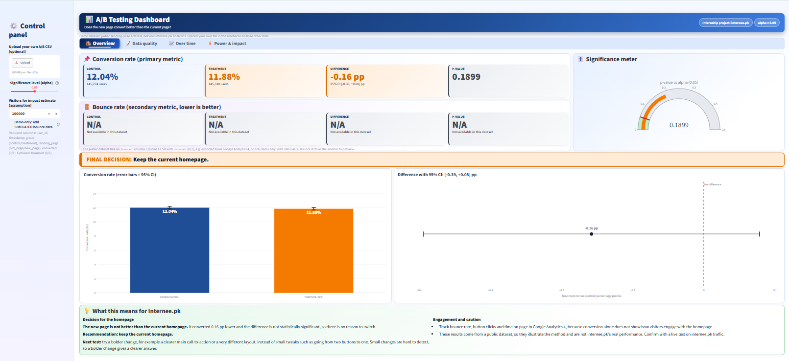
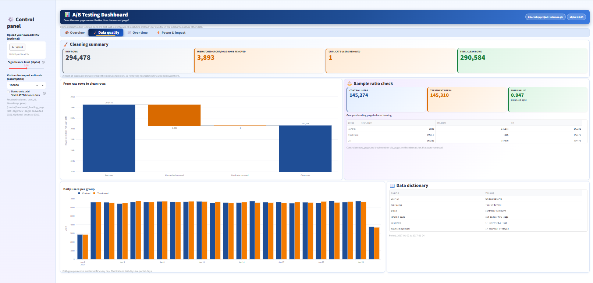
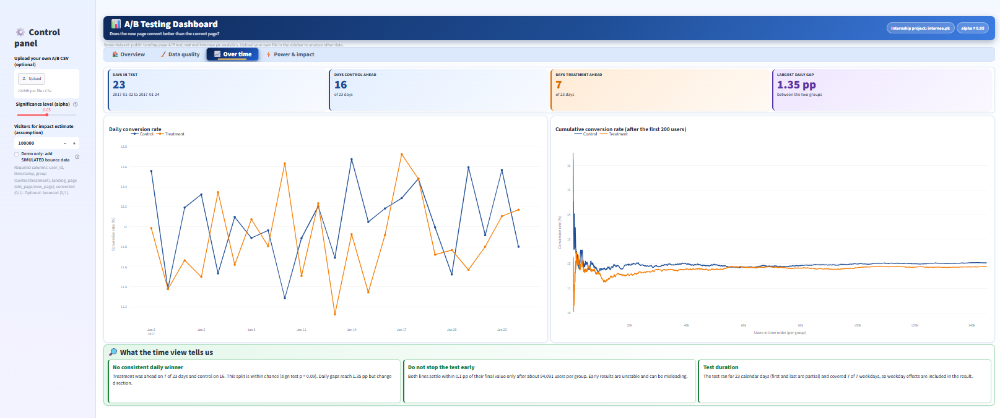
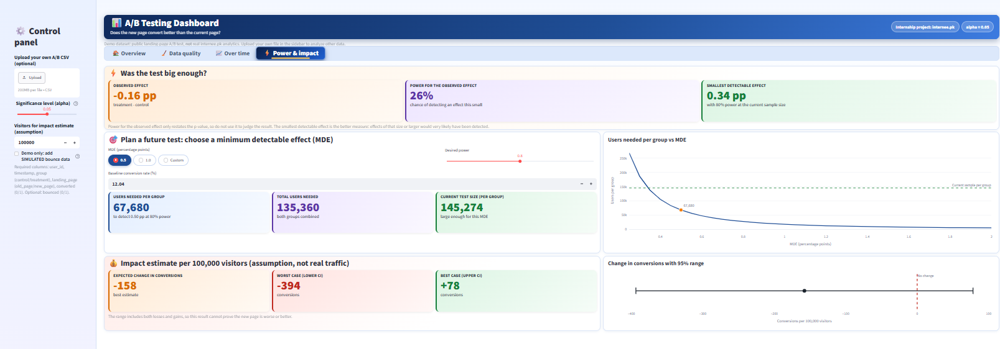

# A/B Testing for Website Optimization

Internship project (internee.pk) by **Farwa Eeman**.

An A/B test analysis and an interactive Streamlit dashboard that answer one question:
**does the new page convert better than the current page?**

> **Data note:** internee.pk analytics were not available for this project, so the analysis uses a **public landing-page A/B test dataset** from Kaggle (`ab_data.csv`).
> The results describe that dataset only. They are **not** internee.pk's real performance.

## Result (public dataset)

| Metric | Control (old page) | Treatment (new page) |
|---|---|---|
| Users (after cleaning) | 145,274 | 145,310 |
| Conversion rate | 12.04% | 11.88% |

- Difference: **-0.16 percentage points** (95% CI: -0.39 to +0.08)
- Two-proportion z-test: **p = 0.1899**, so the difference is **not statistically significant**
- Sample ratio check: p = 0.947 (the 50/50 split is balanced)
- Smallest effect the test could reliably detect: about 0.34 percentage points
- **Final decision: keep the current homepage.**

## Live demo

_Coming soon (deploying on Streamlit Community Cloud)._

## Dashboard preview

**Overview**


**Data quality**


**Over time**


**Power & impact**


## What is in this repository

| File | Purpose |
|---|---|
| `A_B_Testing.ipynb` | Full analysis: cleaning, validity checks, z-test, confidence interval, charts |
| `app.py` | Streamlit dashboard (Overview, Data quality, Over time, Power & impact) |
| `ab_data.csv` | Public demo dataset (294,478 rows) |
| `requirements.txt` | Python libraries needed to run the dashboard |
| `homepage_control.png` | Screenshot of the current internee.pk homepage (control design) |
| `screenshot_*.png` | Screenshots of the four dashboard tabs (shown in the preview above) |

## Method

1. **Cleaning:** removed 3,893 rows where the group did not match the page shown, and 1 duplicate user (290,584 clean rows).
2. **Validity checks:** sample ratio mismatch test, test duration, daily traffic.
3. **Statistical test:** two-proportion z-test (alpha = 0.05), 95% confidence interval, effect size.
4. **Robustness:** simulation of the difference, daily and cumulative conversion over time.
5. **Power:** smallest detectable effect and a sample-size planner.

## Run it on Windows

```
python -m venv venv
venv\Scripts\activate
pip install -r requirements.txt
streamlit run app.py
```

Then open `http://localhost:8501`. Keep `ab_data.csv` in the same folder as `app.py`.

## Dashboard features

- Conversion and bounce-rate cards, a significance meter and a clear final decision
- Adjustable significance level (alpha) that updates the results live
- Optional CSV upload: if your file has a `bounced` column (0/1), bounce rate is analyzed too
- Sample-size and minimum-detectable-effect planner

## Limitations

- Public dataset, not internee.pk's own users. It did not test internee.pk's homepage.
- The dataset has **no bounce-rate column**, so only conversion rate was analyzed. The "simulated bounce data" checkbox in the dashboard is for layout preview only and is **not** a real result.
- One metric and one change; no device or traffic-source segments are available.

## Next steps for internee.pk

1. Track page views, button clicks, sign-ups and bounce rate in Google Analytics 4.
2. Split traffic 50/50 with an A/B testing tool connected to GA4.
3. Set the sample size and duration in advance and run for full weeks.
4. Test a bolder change instead of small tweaks.
5. Re-run this analysis on the exported GA4 data.
